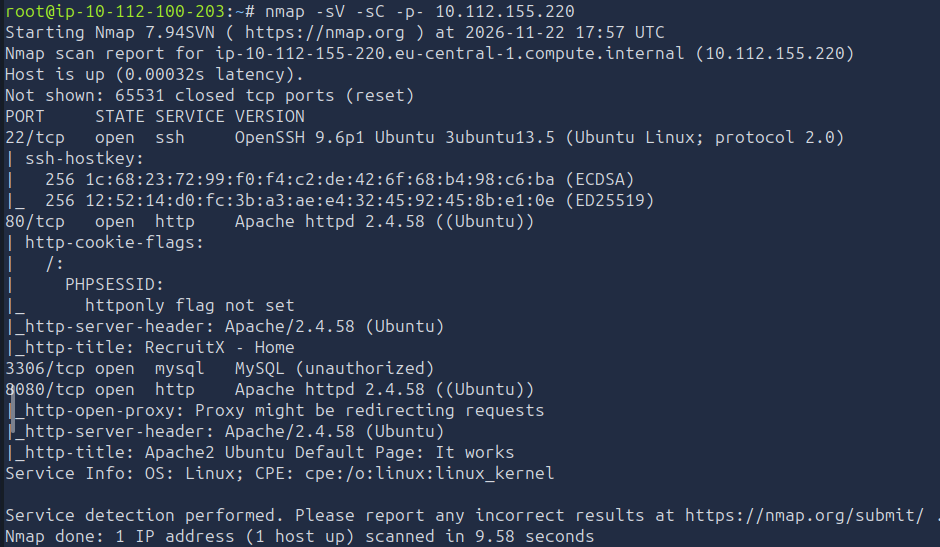
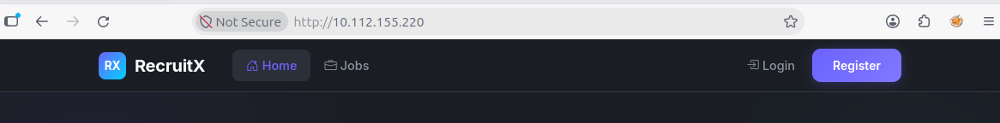
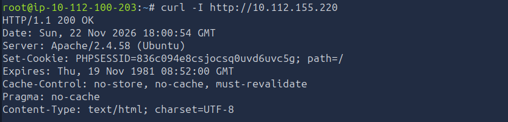
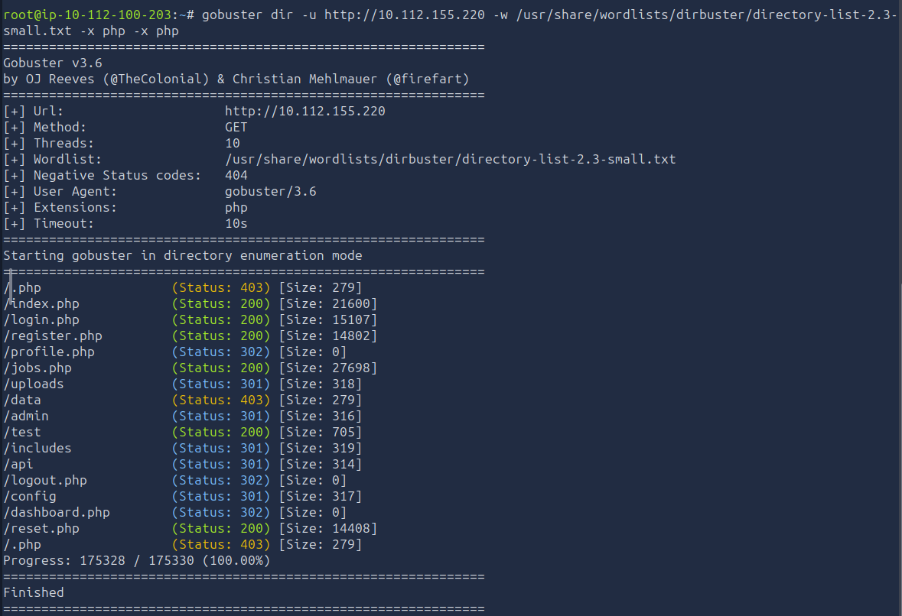
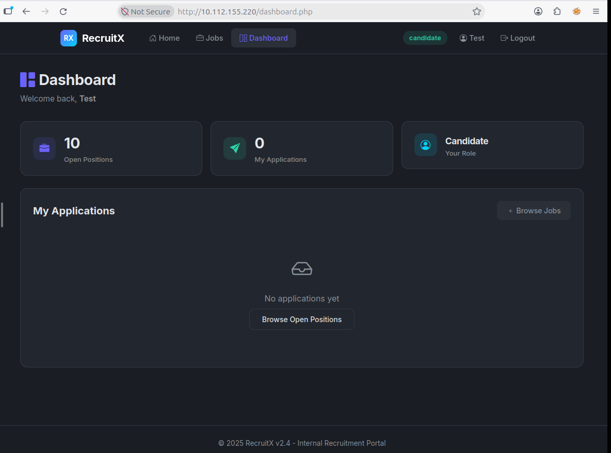
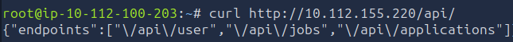

## Recon

### Step 1: Port scan

**Tool:** [Nmap](../Tools.md#nmap), the port scanner.

**Why:** Before touching the app I need to know what the server exposes.
A web app is usually not the only service running on a machine.

`nmap -sV -sC -p- <TARGET_IP>`

- `-p-` scans all 65535 ports, not just the top 1000. Without it I could miss a service on a weird port.
- `-sV` detects service versions, which I can later match against known vulnerabilities.
- `-sC` runs the default scripts, which gave me extra info like the cookie flags.ы

**Result:** 22, 80, 3306 and 8080 are open. MySQL being reachable
from outside is a problem by itself, and it also tells me the app uses a database.
Port 8080 only shows the Apache default page. The session cookie has no HttpOnly flag.

### Step 2: Look at the app and the headers

**Tool:** [Curl](../Tools.md#curl), command-line HTTP client.

**Why:** Before running more tools I want to see what a normal user sees,
and what the server says about itself in the response.

I opened "http://<TARGET_IP>" in the browser: navigation with Home, Jobs, Login and Register,
and a footer with the app version. Then:

`curl -I http://<TARGET_IP>`

- `-I` fetches only the headers, so the output is short.

**Result:** Apache 2.4.58 and a PHPSESSID cookie, so the stack is Apache + PHP + MySQL (LAMP).
The version in the footer is information an attacker doesn't need to get.

### Step 3: Directory enumeration

**Tool:** [Gobuster](../Tools.md#gobuster), web path brute-forcer.

**Why:** The navigation bar only shows what the developers want me to see.
Hidden pages (admin panels, old test files) are usually not linked anywhere.

`gobuster dir -u http://<TARGET_IP> -w <wordlist> -x php`

- `dir` is directory brute-force mode.
- `-w` is the wordlist with names to try.
- `-x php` also tries every word with a `.php` extension, because the stack is PHP (I know that from the headers in the previous step).

**Result:**
- `/admin` - admin panel, redirects to login
- `/api` - API, worth a closer look
- `/reset.php` - password reset, often implemented weakly
- `/uploads` - could be a path to code execution later
- `/config`, `/includes`, `/data`, `/test` - should not be reachable from outside
- `/profile.php`, `/dashboard.php` - need login

### Step 4: Logging in

**Why:** `/profile.php` and `/dashboard.php` redirect to login, so most of the app
is only visible with an account.

I logged in with the test account given in the room (you can also register your own at `/register.php`).
After login I land on `/dashboard.php`. I paid attention to the URLs while clicking around,
especially on my own profile, because that matters for the next stage.

**Result:** Dashboard with open positions, applications and a Browse Jobs option.

### Step 5: API root

**Tool:** [Curl](../Tools.md#curl), command-line HTTP client.

**Why:** Gobuster found `/api`, and APIs often expose data the frontend doesn't show.

`curl http://<TARGET_IP>/api/`

**Result:** It returns a list of all endpoints (`/api/user`, `/api/jobs`, `/api/applications`)
without any authentication. That's information disclosure, and it gives me a map of the API for the next task.

### What I would fix
- Close port 3306 to the outside (bind MySQL to localhost)
- Remove the default page on 8080 or close the port
- Set HttpOnly (and Secure) on session cookies
- Hide version numbers in the footer and headers
- Restrict access to `/config`, `/includes`, `/data`, `/test`
- Require authentication for the API root