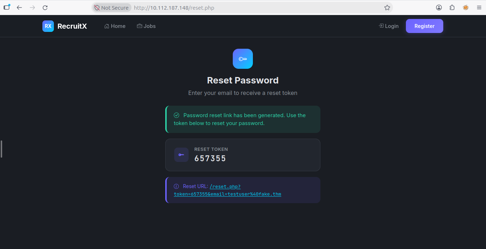
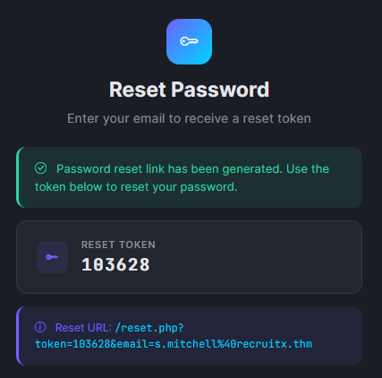
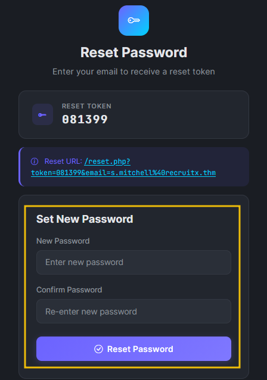
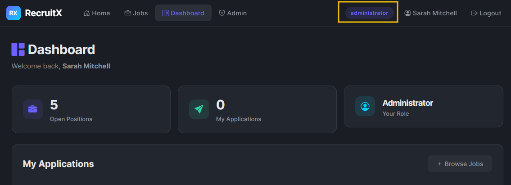

# Task 4: Weak Password Reset

## What it is

A password reset flow lets a user prove ownership of an account (usually via a token
sent to their email) and then set a new password. If the token is predictable, exposed,
or not rate-limited, an attacker can take over any account without knowing the password.

### Step 1: Test the reset flow on my own account

**Why:** Before attacking the admin, I want to understand how the mechanism works,
using an account I already control.

I went to `http://<TARGET_IP>/reset.php` and submitted testing email given in this room (`email`).

**Result:** The reset token was shown directly on the page instead of being sent
by email. That's already a serious flaw: the whole point of email-based reset is that
only the account owner, who has access to the inbox, sees the token.

### Step 2: Look for a pattern in the tokens

**Why:** If the token is predictable or has a small range, I don't need to see
it on screen at all, I can guess it.

I submitted the reset form for my own account a few times and recorded the tokens:
`657355`, `291037`, `503648`.

**Result:** All tokens are 6-digit numbers, so there are only 1,000,000 possible values
(000000-999999). That's a small keyspace for brute-forcing, especially with no rate
limiting (checked that next). Still random-looking, no obvious sequence, but the length
is the weakness.

### Step 3: Request a reset for the administrator

**Why:** From the IDOR task I know the admin's email (`s.mitchell@recruitx.thm`).
Since the token is exposed on screen for my own account, let's check if it's exposed
the same way for any email, not just the account making the request.

I submitted the reset form with `s.mitchell@recruitx.thm`.

**Result:** <!-- fill in: was the token shown directly, same as for my own account? -->

### Step 4: Reset the administrator's password

**Why:** With a valid token for the admin account, I can set a new password
without ever knowing the original one.

I used the token from the previous step on the reset form to set a new password for
`s.mitchell@recruitx.thm`.

**Result:** Password changed successfully.

### Step 5: Log in as the administrator

**Why:** Confirm the takeover actually works.

Logged in at `/login.php` with `s.mitchell@recruitx.thm` and the new password.

**Result:** Logged in as Sarah Mitchell, administrator.

### The chain so far

1. IDOR on `/profile.php` and `/api/user` leaked the admin's email, name and role
2. Weak password reset let me take over that account without knowing the password

Neither issue alone gives admin access. Together, they do.

### What went wrong
- The reset token is shown on screen instead of only being emailed to the account owner
- The token is a 6-digit number, a small keyspace that's realistic to brute-force
- No rate limiting on reset requests or token attempts, so brute-forcing isn't even slow

### What I would fix
- Never display the token in the response; only send it to the registered email
- Use a long, random token (e.g. 32+ character, cryptographically random), not a short number
- Rate-limit reset requests per account/IP, and lock out or delay after repeated failed token attempts
- Expire tokens quickly (a few minutes) and invalidate them after first use