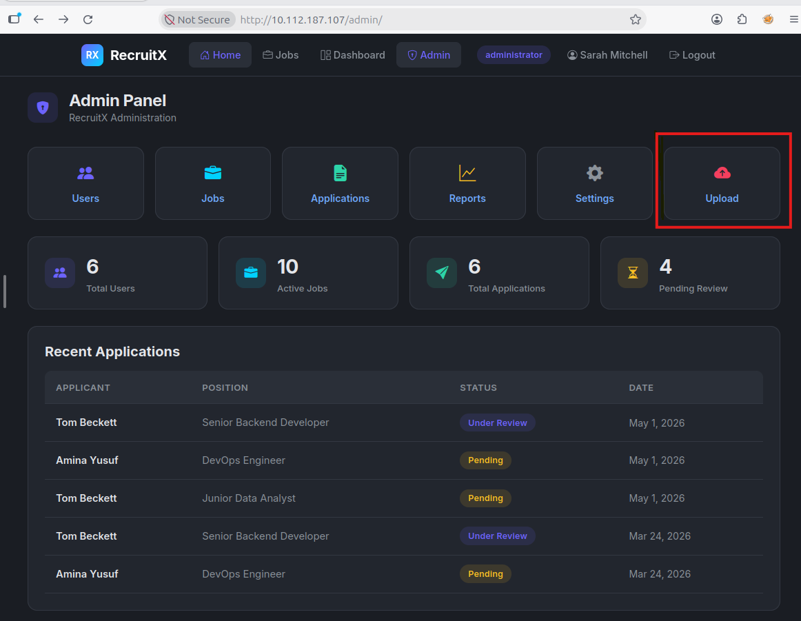
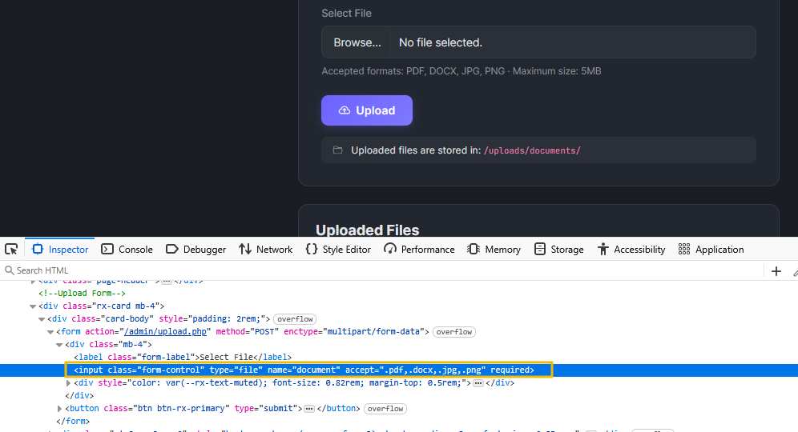
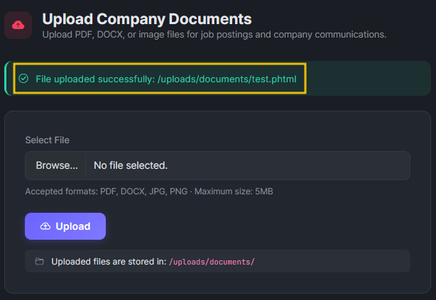
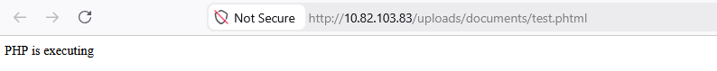

# Task 5: Admin Panel Access

Logged in as the admin now (Sarah Mitchell). Time to check what `/admin` actually has,
since gobuster found it earlier but it needed login.

## Looking around

Went to `/admin`. A bunch of management pages, but `/admin/upload.php` caught my eye
right away. A file upload in an admin panel is usually a good target, if the server
doesn't check uploads properly, you can get code execution.

Checked the upload form with DevTools .It only accepts PDF, DOCX and images according to the `accept` attribute, but that's
just a client-side hint, the browser uses it to filter the file picker. A direct
request can still send anything. The upload path is `/uploads/documents/`

## Testing what the server actually accepts

Tried a plain `.txt` file first (removed the `accept` attribute so I could pick it):

`echo "This is a test file" > test.txt`

Rejected. So there's server-side validation, not just the frontend attribute.

Tried a `.php` file next:

`echo '<?php echo "PHP is executing"; ?>' > test.php`

Also rejected, so `.php` specifically is blocked. Probably a blocklist.

Tried `.phtml` instead, since Apache often runs that as PHP too and developers
sometimes forget to block it:

`echo '<?php echo "PHP is executing"; ?>' > test.phtml`

This one got accepted.

To check it actually runs, I opened `http://<TARGET_IP>/uploads/documents/test.phtml`
directly, and it printed "PHP is executing". So it's not just stored, it executes.

## Why this matters

The upload filter blocks `.php` by name but not other extensions Apache will still
run as PHP. Combined with the fact that uploads land inside the webroot, that's an
easy way to run my own code on the server. Next step: turn this into actual RCE