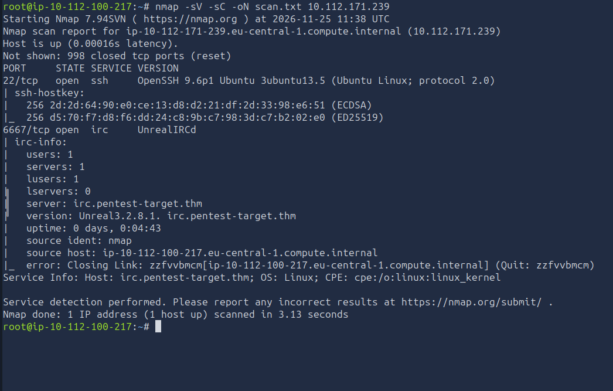

## Enumeration

### Step 1: Port scan with intent

**Why:** Before touching any exploit, I need to know what's actually running on the
target. This time it's not just "run nmap because that's what you do", it's about
reading the output carefully, since every detail here shapes what I try next.

**Tool:** [Nmap](../Tools.md#nmap), network scanner. Finds open ports and
identifies the service/version behind each one.

`nmap -sV -sC -oN scan.txt <TARGET_IP>`

**Result:** Two ports open.
- `22/tcp` - SSH (OpenSSH 9.6p1 on Ubuntu). Not interesting on its own right now,
  but worth remembering if I get credentials later.
- `8889/tcp` - IRC, running UnrealIRCd, version `Unreal3.2.8.1`.

The IRC service stands out: it's not a typical service to find exposed, and more
importantly I now have an exact version string (`Unreal3.2.8.1`) to research.
UnrealIRCd has a history of serious vulnerabilities, so this is the obvious next
thing to look into.