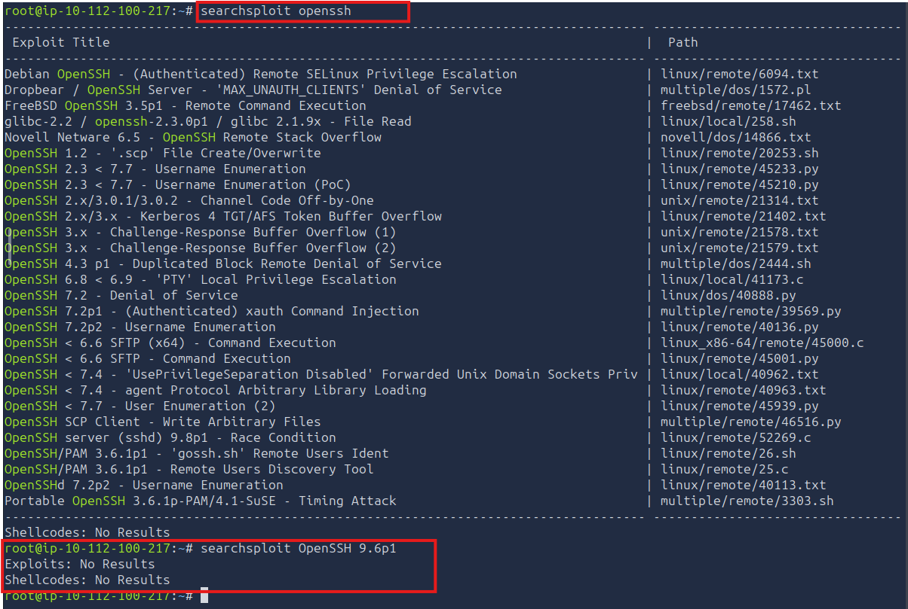
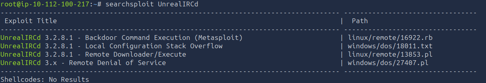

## Vulnerability Analysis

Got two open ports from the scan, now it's about figuring out if either one is
actually exploitable. Two ways to check: just Google the version + "exploit", or
use searchsploit to search Exploit-DB's offline database from the terminal. I did
both for each service.

### OpenSSH

Googled "OpenSSH 9.6p1 exploit" first. Google suggested there's a known
vulnerability for this version, CVE-2024-6387 ("regreSSHion"), which affects
versions 8.5p1 up to (but not including) 9.8p1 on glibc-based Linux distros.
My target's 9.6p1 falls right in that range

Checked with [searchsploit](../Tools.md#searchsploit) anyway:

`searchsploit openssh`

Nothing in Exploit-DB for this specific CVE. Makes sense once I read more about
it: it's a race condition in the signal handler, and the known PoCs need a huge
number of attempts (hours, sometimes days) with very precise timing, and only
work reliably against specific glibc builds. That's probably why there's no
simple, reliable public exploit sitting on Exploit-DB for it.

So this is a real vulnerability, but not a practical path to a foothold for this
engagement. Noting it for the report, and moving on to UnrealIRCd, which looked
like a more realistic lead.

### UnrealIRCd

Same approach: Google first, then searchsploit. Googled the version and it turned out to be a
known issue: back in 2009-2010 the official UnrealIRCd download was secretly
backdoored on some mirrors (CVE-2010-2075). If you're running that version,
anyone can send a special command over IRC and run whatever they want on the
server, no login needed. That's about as bad as it gets.

Checked with searchsploit too, just to make sure there's an actual working
exploit and not just a CVE on paper like with OpenSSH:

`searchsploit unrealircd`

This one's solid, there's even a ready Metasploit module for it, so this is
my way in.

**Result:** UnrealIRCd backdoor is the real path here. OpenSSH's bug is real
but not practical to pull off. Going with UnrealIRCd for initial access.

